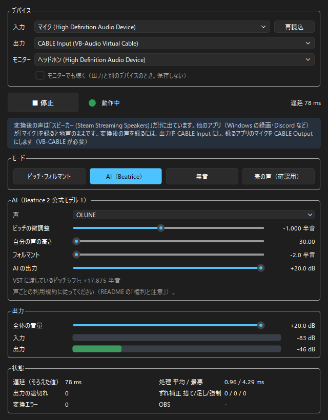
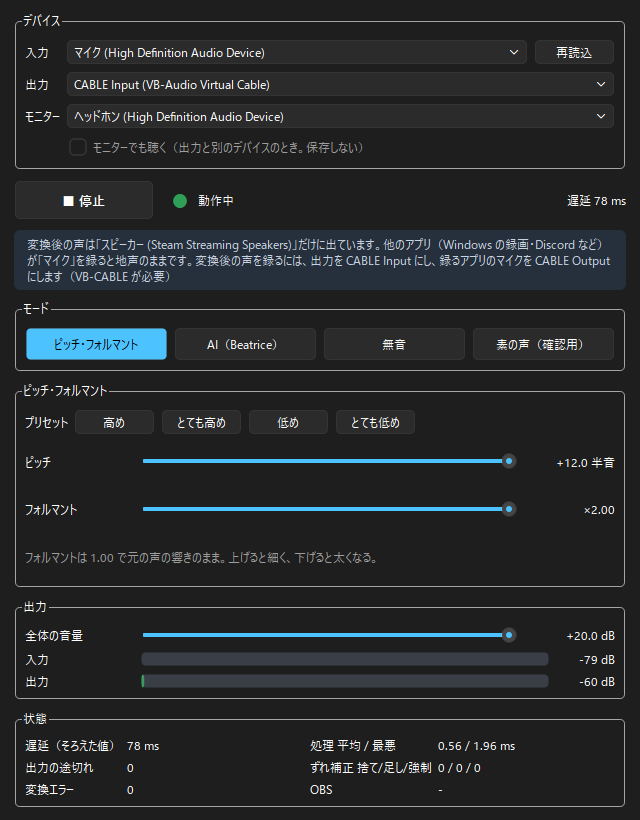
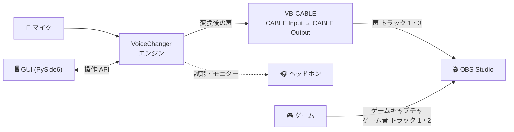
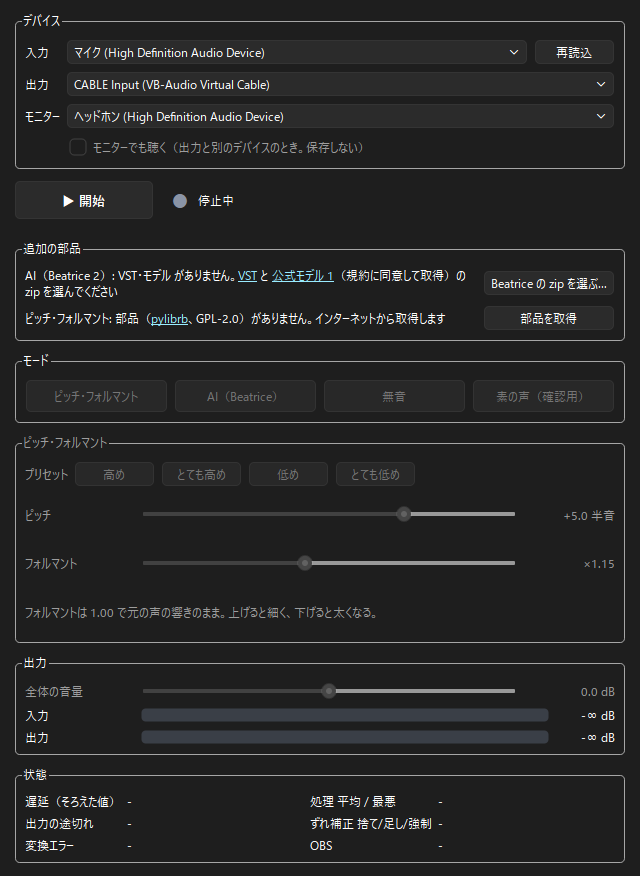

<div align="center">

# 🎙️ VoiceChanger

**ゲーム実況の録画用に、マイクの声をリアルタイムで変えるボイスチェンジャー（Windows）**

ピッチ・フォルマント変換と、AI 声質変換（Beatrice 2）を GUI のボタン 1 つで切り替え。<br>
**素の声を録画に入れない**ことを最優先に設計しています。

[](LICENSE)




</div>

> **English summary** — A real-time voice changer for recording gameplay videos on Windows.
> Mic audio goes through a Python engine (pitch/formant shifting, or AI voice conversion with the official
> Beatrice 2 VST3 running on CPU) into VB-CABLE, which OBS Studio records as a virtual microphone.
> The design goal is that your *unprocessed* voice never reaches the recording: on any processing error the
> engine outputs silence, the "raw voice" check mode is never saved and is refused while OBS is recording,
> and the bundled OBS setup registers only the converted voice and the game's own audio.
> A Windows installer (no Python needed) is attached to each [release](https://github.com/ringo7pie/voicechanger/releases/latest).
> The UI and docs are in Japanese.

---

## ✨ 特徴

- 🎚️ **2 つの変換方式** — ピッチ・フォルマント（DSP）と、AI（Beatrice 2 公式 VST3 を CPU で実行）。動かしたまま切り替え・調整できる
- 🛡️ **地声を漏らさない** — 変換で例外が出たら無音を出す。確認用の「素の声」は保存されず、60 秒で無音に戻り、OBS の録画中は使えない
- 🎬 **OBS を自動設定** — 専用プロファイルとシーンを作り、音声を 3 トラック（合成／ゲーム音／声）に分けて録る
- ⏱️ **低遅延** — 全モードで遅延を 78 ms にそろえ、モードを替えても声のタイミングがずれない
- 🧪 **自己試験付き** — GUI が開始 → 各モード → 停止を自動で回し、出力の音量で合否を判定する

## 🖼️ 画面

| ピッチ・フォルマント | AI（Beatrice） |
|:---:|:---:|
|  |  |

## 🔀 音の経路



生のマイクとデスクトップ音声は OBS に登録しません（地声や通知音が録画に入らない）。

## 🎛️ モード

| モード | 内容 |
|---|---|
| ピッチ・フォルマント | 声の高さ（ピッチ）と響き（フォルマント）を別々に変える。元の声の特徴は残る |
| AI（Beatrice） | Beatrice 2 の公式モデルで、別人の声に変える（CPU で動作） |
| 無音 | 何も出さない |
| 素の声（確認用） | 変換しない声。保存されず、60 秒で無音に戻り、OBS の録画中は使えない |

## 📥 インストーラーで入れる（おすすめ）

1. [Releases](https://github.com/ringo7pie/voicechanger/releases/latest) から `VoiceChanger-Setup-<版>.exe` をダウンロードして実行する。Python は要りません。
   - 署名していないので、Windows の SmartScreen が「PC を保護しました」と出したら「詳細情報」→「実行」を押す。
   - 「VB-CABLE を入れる」を選ぶと、仮想マイク（CABLE Input / CABLE Output）も入る（全ユーザー向けのインストールで、まだ入っていないとき）。
     VB-CABLE のセットアップ画面で「Install Driver」を押し、終わったら PC を再起動する。
2. VoiceChanger を開くと「追加の部品」欄が出るので、使うモードの部品を入れる（入れると欄は消える）。
   - **ピッチ・フォルマント**: 「部品を取得」を押す（PyPI から pylibrb を取得し、SHA-256 を照合して入れる）。
   - **AI（Beatrice）**: [Beatrice 2 の公式ページ](https://prj-beatrice.com/)から VST の zip と、規約に同意して公式モデル 1 の zip を
     ブラウザで取得し、「Beatrice の zip を選ぶ…」で 2 つとも選ぶ（規約で再頒布できないので、インストーラーには入れていない）。
3. 録画には [OBS Studio](https://obsproject.com/) を入れ、マイクに「CABLE Output」を選ぶ（下の「録画」）。



- 設定・ログ・追加の部品は `%LOCALAPPDATA%\VoiceChanger` に保存する。アンインストールしても消えない（要らなければ手で消す）。
- インストーラー版のエンジンは `VoiceChanger.exe engine <コマンド>` で呼べる（例: `engine addons --beatrice-zip <zip>`、`engine devices`）。
- OBS の録画設定の自動作成（`tools\setup_obs.ps1`）はソース版だけの機能。

## 💻 動作環境

- Windows 10 / 11（64 bit）
- [VB-CABLE](https://vb-audio.com/Cable/)（仮想マイク。録画・配信に使うとき。インストーラーから入れられる）
- [OBS Studio](https://obsproject.com/) 33（録画するとき）
- AI モードを使うとき: [Beatrice 2](https://prj-beatrice.com/) の公式 VST とモデル（ブラウザで取得する）
- ソースから動かすとき: Python 3.14（リポジトリの `.venv` に依存を入れる。下の「ソースから導入」）

## 📦 ソースから導入

| 段階 | コマンド | 内容 |
|---|---|---|
| 1 | `pwsh -NoProfile -File .\tools\install_engine_deps.ps1` | Python の依存（PySide6 を含む）と、Beatrice の VST・モデルの展開。Beatrice の zip はブラウザで公式ページから取得し、このフォルダの `Downloads\` に置く |
| 2 | `pwsh -NoProfile -File .\tools\make_shortcut.ps1` | デスクトップのショートカット（`-Remove` で消す） |
| 3 | `pwsh -NoProfile -File .\tools\install_audio_tools.ps1` | VB-CABLE と OBS Studio（管理者権限の確認が出る。終わったら再起動） |

段階 3 の後に、`pwsh -NoProfile -File .\tools\setup_obs.ps1` で OBS の録画設定を作る（ゲームの起動中は流さない。ゲームが固まったことがある）。

> [!WARNING]
> VB-CABLE を入れると、Windows の既定の再生デバイスが CABLE Input に変わることがあります（再起動後にも戻ることがある）。
> サウンドの設定で既定の再生をヘッドホンなどに戻してください。GUI は既定の再生が CABLE のとき赤い警告を出します。

## 🚀 使い方（GUI）

1. デスクトップの「VoiceChanger」を開く（無ければ、このフォルダの `VoiceChanger.cmd` をダブルクリック）。
2. 「入力」にマイク、「出力」に音を出す先を選ぶ。
   - 自分で聴いて試すとき: ヘッドホン
   - 録画・配信に使うとき: `CABLE Input (VB-Audio Virtual Cable)`（VB-CABLE を入れた後）
3. 「▶ 開始」を押す。AI モデルの読み込みで 4 秒ほどかかり、「動作中」になる。
4. モードを選び、スライダやプリセットで声を調整する。動かしている間も、その場で音に反映される。
5. 終わったら「■ 停止」を押すか、ウィンドウを閉じる（マイクを放す）。

- 調整した値・選んだデバイス・モードは自動で保存され、次に開いたとき引き継がれる（素の声とモニターは保存しない）。
- 動作中にデバイスを変えると、自動で止めて起動し直す。
- 「モニターでも聴く」は、出力を CABLE Input にしたまま、ヘッドホンでも自分の変換後の声を聴くためのもの。
- 「AI」の「自分の声の高さ」は、録音から測った値（MIDI ノート番号）が最初に入っている。声が高すぎ・低すぎると感じたら「ピッチの微調整」で合わせる。
- 「状態」の「出力の途切れ」「変換エラー」が増え続ける場合は、`data\logs\engine.log` を見る。

## 🎬 録画（OBS Studio）

OBS には専用のプロファイルとシーンコレクション「VoiceChanger」を作る（`tools\setup_obs.ps1`。もう一度流しても同じ設定になる）。

| 入力 | 中身 | トラック |
|---|---|---|
| 声（VoiceChanger） | 仮想マイク CABLE Output（変換後の声）。同期補正 -110ms（推定値） | 1・3 |
| ゲームキャプチャ | ゲームの映像と音（ゲームのプロセスの音だけ。聞いている機器に依らない） | 1・2 |
| 画面キャプチャ | ゲームを捕まえていないときの予備（音なし） | - |

- 録画: MKV、H.264（NVENC、CQP 20）、1920x1080 60fps、音声 3 トラック（1＝合成、2＝ゲーム音、3＝声）。保存先は `recordings\`。
- 録るとき: VoiceChanger の出力を CABLE Input にして「開始」してから、OBS の「録画開始」を押す。
- 窓で動かすゲームは「全画面のゲーム」では捕まらない。ゲームキャプチャのプロパティで「特定のウィンドウ」にする。
- 試し録りと検査: `pwsh -NoProfile -File .\tools\record_trial.ps1`（動いている VoiceChanger の声を 10 秒録り、トラックごとの音量を出す）。

## ⌨️ コマンドで使う（任意）

| 操作 | コマンド |
|---|---|
| 起動（ブラウザの操作画面） | `pwsh -NoProfile -File .\Run.ps1` |
| モードの切り替え | `pwsh -NoProfile -File .\Run.ps1 -Mode ai` |
| 状態 / 停止 | `pwsh -NoProfile -File .\Run.ps1 -Status` / `-Stop` |
| 準備状況（何も起動しない） | `pwsh -NoProfile -File .\Run.ps1 -Plan` |
| 聴き比べページを作る | `pwsh -NoProfile -File .\tools\make_listen_samples.ps1` |

GUI は、`Run.ps1` で起動済みのエンジンにも接続できる（その場合、GUI を閉じてもエンジンは止まらない）。

## 🔍 既知の性質

- ヘッドホンで自分の声を聴くと、約 0.12 秒遅れて聞こえる（全モードでそろえた遅延 78ms ＋ 出力の溜め 30ms ＋ デバイスの遅延）。録画には問題ないが、聴きながら話すと違和感がある。
- 出力をスピーカーにすると、マイクが拾ってハウリングする。ヘッドホンを使う。
- ピッチのスライダを動かしている間は、遅延の調整が入るので小さな音飛びが出ることがある。
- ピッチ・フォルマント変換は元の声の特徴が残る。別人の声にしたいときは AI を使う。
- 他のアプリ（Windows の録画、Discord など）が物理マイクを直接録ると、地声が入る。変換後の声を渡すには、出力を CABLE Input にし、録るアプリのマイクを CABLE Output にする。

## 🧪 開発

```powershell
# 単体試験（リポジトリのルートで）
.\.venv\Scripts\python.exe -m unittest discover -s tests -t .

# GUI の通し試験（WAV を入力にし、耳に聞こえない出力へ流す。数十秒ウィンドウが出る）
.\.venv\Scripts\python.exe -m voicechanger.gui --self-test --input-wav <WAV> --output-device "<出力デバイス名>" --screenshot-dir out\shots
```

| パス | 内容 |
|---|---|
| `voicechanger/` | エンジン（入出力・変換・操作 API） |
| `voicechanger/gui/` | GUI（PySide6）。エンジンは別プロセスで起動し、操作 API で操作する |
| `config/` | 既定の設定、取得物の URL・版・SHA-256 |
| `tools/` | 導入・確認・OBS 設定・試験・インストーラー作成のスクリプト |
| `packaging/` | PyInstaller の spec、Inno Setup のスクリプト、第三者の部品の表記 |
| `tests/` | unittest |

インストーラーを作る（PyInstaller と Inno Setup 6 が要る）:

```powershell
.\.venv\Scripts\python.exe -m pip install -r requirements-build.txt
winget install JRSoftware.InnoSetup
pwsh -NoProfile -File .\tools\build_installer.ps1   # → out\installer\VoiceChanger-Setup-<版>.exe
```

- 自分の声の録音から「自分の声の高さ」を測るときは、環境変数 `VOICECHANGER_SELF_VOICE_DIR` に WAV のフォルダを入れる（`engine self-pitch`）。
- 試験でデータの置き場所を分けるときは、環境変数 `VOICECHANGER_DATA_DIR` を使う。

## ⚖️ 権利と注意

- **Beatrice 2 公式モデル 1**（規約の全文はモデルの zip に同梱の `README.txt`）
  - 用途は声の変換に限る。モデルのファイル（`.bin`）と画像は再頒布できない（**このリポジトリには入れていない**。各自で公式ページから取得する）。
  - つくよみちゃんの声に変換した音声は、次の目的に使えない: 人を批判・攻撃すること、特定の政治的立場・宗教・思想への賛同や反対を呼びかけること、刺激の強い表現をゾーニングなしで公開すること、他者に二次利用（素材としての利用）を許す形で公開すること。
  - つくよみちゃん・刻鳴時雨は、変換音声をそのキャラクターの声として使わない場合はクレジット不要。そのキャラクターの声として使う場合は、それぞれのキャラクターの規約を確認する。
  - OLUNE は自由に使える。
  - 声を切り替えた直後などに中間的な声になった場合は、関わったすべての声の規約に従う。
- YouTube の動画のライセンスは「標準」のままにする（クリエイティブ・コモンズにすると二次利用を許す形になる）。
- VB-CABLE は寄付ウェア（https://vb-audio.com/Services/licensing.htm）。収益化する場合の扱いは自分で判断する。
- 素の声が録画に漏れ得る経路: 「素の声」モード、モニター、Windows のマイクの「このデバイスを聴く」、マイクを再生する他のアプリ（Discord のマイクテストなど）。

## 📄 ライセンス

このリポジトリのコードは **GPL-3.0-or-later** です（全文は [LICENSE](LICENSE)）。

使っているライブラリのライセンス: pedalboard（GPLv3）、obsws-python（GPL-3.0-only）、PySide6（LGPL）、numpy・sounddevice（BSD / MIT 系）。
インストーラーに入っている部品の一覧は [packaging/THIRD-PARTY-NOTICES.txt](packaging/THIRD-PARTY-NOTICES.txt)。

- **pylibrb**（Rubber Band のバインディング。ピッチ・フォルマントに必須）: 作者の表記は「GPLv2」で、「or later」の表明は見つかっていません
  （Rubber Band 本体は GPL-2.0-or-later）。GPLv2 のみの場合は GPLv3 の pedalboard と同じ配布物に入れられない可能性があるため、
  インストーラーにもリポジトリにも同梱せず、利用者が PyPI から取得します（GUI の「部品を取得」、ソース版は `requirements-optional.txt`）。
  入れないとピッチ・フォルマントのモードは使えません（AI・無音・素の声は動きます）。
- **VB-CABLE**: VB-Audio Software の寄付ウェア。規約（https://vb-audio.com/Services/licensing.htm）に従い、Driver Pack46 をそのまま（AS IS）インストーラーに同梱しています。
  VB-CABLE is a donationware, all participations are welcome. — www.vb-cable.com
